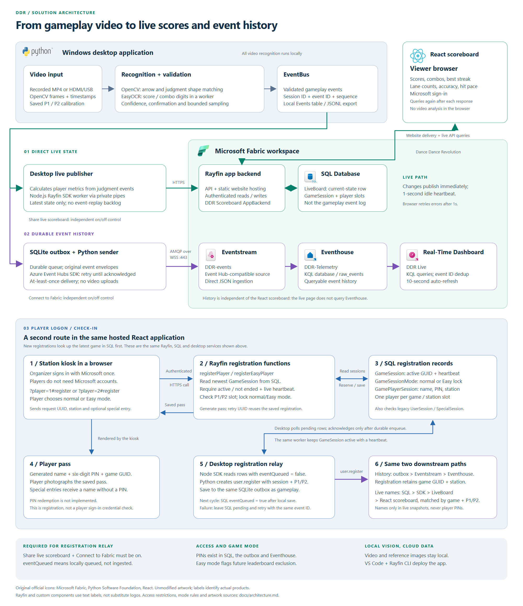
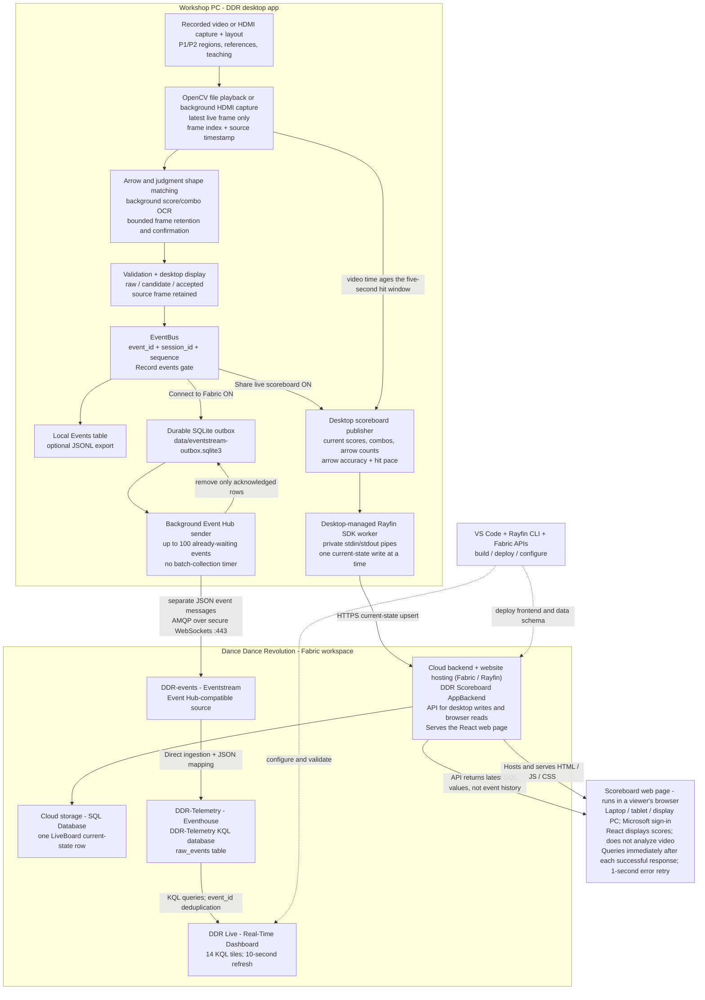

# DDR workshop: overall architecture

One desktop event source feeds two independent publishing paths. The live path
publishes current state directly to Rayfin; the historical path preserves events
in Eventhouse. This diagram focuses on components and data flow.



[Editable, self-contained SVG](architecture-product-logos.svg) |
[Full-resolution PNG](architecture-product-logos.png) |
[Earlier text-only diagram](architecture.svg)

### Product artwork sources

The product-logo diagram uses original artwork without recoloring, cropping,
rotation, or distortion. Logos identify the products actually used; Rayfin and
custom application components are text-labeled rather than assigned substitute
product logos. The SVG embeds its artwork and works offline.

- **Microsoft Fabric, SQL Database, Eventstream, Eventhouse, Real-Time Dashboard:**
  [official Fabric icons and architecture-diagram usage terms](https://learn.microsoft.com/en-us/fabric/fundamentals/icons),
  from Microsoft's [Icons.zip](https://github.com/microsoft/fabric-samples/blob/main/docs-samples/Icons.zip),
  package version 6.1.0. Microsoft permits use of these icons in architecture
  diagrams, training materials, and documentation; other rights are reserved.
- **Python:** [Python Software Foundation logo and usage guidance](https://www.python.org/community/logos/);
  [original SVG](https://www.python.org/static/community_logos/python-logo-generic.svg).
  Python and its logo are trademarks of the Python Software Foundation.
- **React:** [original React website logo](https://github.com/reactjs/react.dev/blob/main/public/images/brand/logo_dark.svg),
  from [react.dev](https://react.dev/), by Meta Platforms, Inc. and contributors.
  Website content is provided under
  [Creative Commons Attribution 4.0](https://github.com/reactjs/react.dev/blob/main/LICENSE-DOCS.md).
  The original artwork is embedded unchanged; its placement in this diagram is new.

The live browser reads current SQL-backed state through Rayfin; it does not
consume the historical Eventhouse feed. The diagram's **Player logon / check-in**
section expands the second route in the same React app: organizer authentication,
station selection, registration functions, SQL records, the returned player pass,
desktop relay, and both downstream uses. Repeated service names in that section
refer to the same components above, not additional deployments.



## Cloud backend versus scoreboard web page

These are two parts of the same scoreboard application, not two scoreboards:

- **Cloud backend + website hosting (Fabric / Rayfin):** runs in Fabric.
  Receives desktop updates through its API, stores the latest state in SQL,
  and serves the scoreboard website. It is not a spectator screen.
- **Scoreboard web page (React):** runs in a browser on a laptop, tablet,
  or display PC. After Microsoft sign-in, it reads the cloud API and displays
  the latest scores. It does not analyze video or query Eventhouse.

The live flow is **desktop calculates scores -> cloud API stores them in SQL
-> browser reads the API and displays them**. React is the technology used to
build the web page; Rayfin provides its cloud backend and hosting.

## What changed

The workshop no longer needs a local Vite server, local snapshot file, or
`#publish` broadcaster tab. The desktop performs the state calculations internally
and owns a small SDK worker process. It starts and stops that process when sharing
is enabled or disabled.

Vite remains available for **frontend development and building static assets**.
It is not in the live workshop data path.

## The two paths

| | Direct live scoreboard | Fabric event history |
|---|---|---|
| Desktop control | Share live scoreboard | Connect to Fabric |
| Publisher | Desktop-managed Rayfin SDK worker | Background Python Event Hub sender |
| Local state | Latest in-memory player state | Durable SQLite queue of unsent events |
| Cloud target | Rayfin SQL `LiveBoard` current-state row | Eventstream -> Eventhouse `raw_events` |
| Delivery | Latest state after each completed request; no replay queue | Original events, ordered within a session, retained until acknowledged |
| Cadence | Changed state wakes publishing immediately; one-second idle heartbeat and error retry | Immediate send; groups only events already waiting |
| Consumer | Hosted React scoreboard, next query immediately after success; one-second error retry | DDR Live KQL dashboard, ten-second auto-refresh |
| On failure | Visible desktop error; retain latest state for retry | Durable retry/backoff; duplicate deliveries possible |
| What remains running | DDR desktop app | DDR desktop app |

Both feeds use recorded event envelopes from the selected source. Turning off
**Record events** stops new gameplay events; lifecycle announcements continue.
Their connect/share controls remain independent.
Neither feed sends video footage or teaching/reference images.

## Shared-device player registration

The Rayfin frontend's `#register` route is an organizer-authenticated kiosk.
Players need no Microsoft accounts. SQL `GameSession` rows track the game GUID
and heartbeat published by the desktop. `GamePlayerSession` holds the generated
name, optional PIN, game GUID, station, registration type, and relay status.
Required `?player=1` / `?player=2` kiosk flags persist `P1` / `P2` on the
registration and event envelope. A unique game/player `slotKey` allows just two
rows per game, shared by normal and no-PIN special entries; SQL rejects racing
claims for the same station. Normal names and PINs have unique reservation keys.
The tablet invokes one authenticated `registerPlayerWithDifficulty` Rayfin function, passing
a request UUID, station, difficulty, and optional special name. The server queries SQL for the **newest `GameSession` by `startedAt`**, requires
that game to be active and not ended, and verifies its desktop heartbeat. It
does not search backward for an older active game or trust a browser-supplied
game ID. It also checks `GamePlayerSession` for an already-saved request UUID
(safe retry) or an occupied game/P1-or-P2 slot, plus legacy `UserSession` and
`SpecialSession` registrations. For a new registration, it generates credentials,
checks history, and creates the slot via the
caller-scoped `ctx.getDataClient()`. Retry IDs recover a saved pass without
claiming a second slot; the function does not elevate database permissions.
Only player-pass fields return to the tablet. Per-operation duration/status logs
exclude names, PINs, tokens, and database response bodies.
The pass remains visible for five seconds and is then removed from the kiosk,
which shows **GAME IN PROGRESS**. A separate authenticated `getKioskStatus`
poll returns only the newest open game ID and this station's occupancy, using the
same slot checks as registration. Refreshing an occupied station does not expose
the previous pass or allow another registration. Only a new available game
session reopens check-in; no slots or registration records are deleted.
Connection errors retain the lock and show a warning. A confirmed session change
clears old drafts and ignores in-flight registration responses from the old game.
Historical `UserSession` and `SpecialSession` rows remain readable but cannot be
created or have their identity fields updated through the old APIs. Their assigned
stations still count; ambiguous pre-limit games must be replaced with a new game.
Corner gestures register the three special names but
never bypass Microsoft authentication or grant authorization.
These tables require Microsoft sign-in and Fabric app access. Every signed-in app
user is an operator, including for registration/PIN reads and desktop publishing;
there is no personal email allowlist. Share app access only with trusted operators.
Anonymous users remain blocked, and the scoreboard display omits PINs.
The kiosk rejects inactive or stale games.

The desktop SDK worker reads pending registrations with each publish cycle.
Current slots and historical registrations share a 25-row limit, ordered by creation time,
and are acknowledged to their respective SQL tables only after durable enqueue.
Python writes their `user.register` envelopes into the same durable Eventstream
outbox as gameplay. Only a successful queue write is acknowledged back to SQL
on the next cycle. `eventQueued` means queued, not Eventhouse-ingested.
Failures retain SQL rows for retry; duplicate deliveries use the same event ID.
Normal registrations include their six-digit string PIN in `payload.pin`;
special no-PIN registrations omit it. The PIN is stored in the local outbox and
Eventhouse, so restrict both to trusted organizers. Public scoreboard snapshots
and logs still exclude PINs. Already relayed registrations are not backfilled.
Players photograph the saved name/PIN screen for future validation. The SDK worker
joins `GamePlayerSession` names to the current game GUID and P1/P2 station before
publishing `LiveBoard`, so the live scoreboard displays the registered names.
This name enrichment does not send PINs to viewers or attach identities to
gameplay event payloads. PIN redemption is not implemented; this is player
registration, not authentication using a previously issued PIN.

The kiosk offers independent per-player difficulty choices: Easy (0), Normal 3
(3), and Normal 4 (4). `registerPlayerWithDifficulty` validates the numeric value,
then saves it as `GamePlayerSession.difficulty` and derives
`excludeFromLeaderboard` from whether difficulty is 0. Slot reservation remains
atomic, but no game-wide mode lock is consulted or created. Concurrent P1/P2
registrations and special entries retain their own choices. Retries preserve
the saved difficulty and reject a different known choice for the same request.

The legacy `GameSessionMode` entity remains declared to avoid deleting existing
rows, but is unused. Cached registration endpoints stay available without shared
mode inheritance; legacy Normal entries have unknown numeric difficulty, while
known legacy Easy entries map to 0. Old rows and events are not rewritten.
The desktop relays `user.register.payload.difficulty` as a number (0, 3 or 4 for
new choices) and `payload.exclude_from_leaderboard` as a boolean. Future
leaderboard consumers must join by game session and player and exclude only
flagged registrations. Live scoreboard participation and gameplay event
calculations are unaffected. The kiosk records the requested difficulty; it
does not change settings on the DDR machine.

Normal 4 changes only the derived score: the SDK publisher applies 1.25 to the
entire raw running total and rounds once to a whole point, with halves rounded
up. It joins registration by current game ID and player on every heartbeat so
late registration applies retroactively, without multiplying previous adjusted
totals. The published snapshot retains `baseRunningScore`, `difficulty`, and the
adjusted `runningScore`. Easy/Normal 3 and unregistered or legacy players use 1.
Judgment events, OCR values, counts, streaks and pace are not multiplied.

This adds a SQL registration path, not an Eventhouse query connector. Both
**Share live scoreboard** and **Connect to Fabric** must be configured for
end-to-end registration delivery. The expanded logon section of the product-logo diagram shows how this
registration relay joins the gameplay history path at the desktop outbox and
how registered names enrich the separate live scoreboard path.

## Desktop video sources

**Video file** preserves sequential playback, frame stepping, and explicit
seek detection. **HDMI input** enumerates named Windows DirectShow devices
without opening them, then opens only the user-selected card. Opening and
reading occur on a dedicated capture thread with a single latest-frame slot.
Tk polls for new frames without blocking on the driver.

HDMI preview can freeze for calibration, but capture continues and resuming
returns to the newest frame. Live events use `source_mode: live`, capture frame
indices, and monotonic milliseconds since the connection opened. They flow
through the same analysis, game-end GUID rotation, scoreboard, and durable
publishing paths as replay events. Connecting emits `new_session` with reason
`hdmi_connected`. Switching sources stops analysis, invalidates queued OCR, and
starts a fresh session only after the new source delivers a valid frame.
Calibration is explicitly fitted or removed when the source resolution changes.

No audio or video-file recording is added. Connection failures, signal loss,
five-second frame stalls, and resolution changes are visible errors rather
than EOF or successful blank frames. A blocked driver shutdown is reported;
the app does not silently keep capturing or open another copy of the device.

## Events and calculations

Events carry `event_id`, `session_id`, `sequence`, `event_type`, `player`,
`frame_index`, `video_time_ms`, `observed_at_utc`, `payload` and confidence.

- `score_changed`: accepted score changes with previous/new values.
- `combo`: newly accepted current combo in `payload.value`, including zero,
  with no `previous_value` or `new_value`. Stable readings do not emit again.
  The Events table displays the current number; JSONL and outbox delivery keep
  the same payload. Legacy queued `combo_changed` events are unchanged and
  the scoreboard accepts both formats with shared per-player sequence ordering.
- `score_observed`: unconfirmed score candidates, shown separately.
- Arrow references identify activity using fresh `active` samples; old `hit`/`miss`
  arrow images are ignored with a recalibration warning. Old `appeared` samples
  are also ignored. Optional per-region `empty` references suppress look-alike
  receptors: Active must pass the configured shape threshold and exceed the
  best Empty mask score in the learned color by more than 0.02.
  Empty masks lacking contrast cannot veto; diagnostics explain this explicitly.
  Ties and near-ties remain idle.
  All five directions for each player have independent Active/Empty capture,
  thumbnail, clear, gallery, and individual deletion controls. Both reference sets
  serialize and rescale with layouts. Existing colored samples remain usable,
  but the default engine now uses `ArrowShapeMatcher` in `arrow_shapes.py`.
  It reuses shape extraction/search helpers, caches three near-native scale
  templates per sample, and searches at half resolution. `arrow_search_bounds`
  extends downward by half a box height, clamps to the source, and never expands
  across lanes. Cyan dashed overlays expose search bounds without changing
  calibration coordinates. Unusable/colorless examples are explicitly flagged;
  no whole-crop grayscale fallback is used. Cache rebuilding follows
  capture/delete/clear/load/rescale through `set_regions`.
  Arrow diagnostics report positive/negative scores, source frame/time, threshold,
  search and best-match bounds, and calibration warnings.
  Without Active Arrow calibration no lane evidence is produced.
- `judgement`: one event per recognized outcome, whether directions are known
  or uncertain. `payload.outcome` and `state` are hit/miss, `judgment` is the
  original tier (or legacy ungraded `hit`), and `step_directions` preserves all
  matched lanes. `step_arrow_count` is their count; `direction` is set only for
  a single matched lane. No new `arrow_miss`,
  `judgment_hit`, or `judgment_miss` events are emitted.
  Arrow activity alone never determines success or failure, even without a judgment box.
- `arrow`: reports only confirmed
  arrow activity, with `state: "active"` and `evidence: "arrow_activity"`.
  It emits immediately on activation, without waiting for a judgment or requiring
  a judgment region. The event has its own direction and confidence, and
  `activity_video_time_ms` preserves onset while the event timestamp reflects
  confirmation. Held activity and repeated paused frames do not repeat it.
  Its payload contains no outcome, tier, or judgment link.
  Only the later `judgement` can add outcome counts, points, or lane accuracy.
  This replaces the earlier activity-only `arrow_hit` name; queued historical
  messages are unchanged and remain accepted without scoring their activity.
- Per-player `judgment` regions use cached letter-shape matching by default.
  `judgment_shapes.py` learns the dominant saturated hue from each positive
  reference, filters small components, then prepares 18 scaled binary masks.
  Each frame searches those masks at half resolution with normalized correlation.
  The search expands by 40x12 pixels on each side for a 286x53 calibrated crop,
  proportionally scaled and frame-clamped via `judgment_search_bounds`.
  Green capture boxes remain unchanged; yellow dashed overlays expose search
  bounds. Diagnostics report the engine, search coordinates and best match bounds.
  Invalid/unsaturated references produce explicit calibration warnings and block
  recognition if none are usable; there is no implicit grayscale fallback.
  Capture/delete/clear/load/rescale operations rebuild caches through `set_regions`.
  Judgment shape similarity has its own threshold (default 0.65, not equivalent
  to the former grayscale similarity). Arrow activity uses its own shape threshold (default 0.55);
  changing either cannot change the other or the game-end setting.
  Category ranking retains best and runner-up scores from the same matching
  pass for diagnostics. A gap below 0.02 is ambiguous. Optional per-player
  `reference_images.empty` samples mean No judgment; their full-crop masks are
  cached for each learned lettering hue. An outcome must beat their best
  non-flat spatial match for its hue by more than 0.02 or it is classified idle.
  A negative with no usable color-mask contrast cannot veto and is reported.
  Legacy `idle` samples
  remain ignored. Positive/negative examples support capture, per-category
  galleries and individual deletion, save/load and rescaling.
  Arrow confirmation defaults to one frame and judgment confirmation independently
  defaults to two matching frames. No-match, ambiguous and unreadable observations
  clear pending judgment evidence without rearming its active latch. Changing
  judgment confirmation clears its pending evidence, not its active latch or
  arrow/game-end settings. Existing layouts get the new two-frame runtime default.
  Judgment cards show frame
  time, scores, threshold, ambiguity margin, confirmation progress, latch,
  rearm elapsed time, recording state, and the current acceptance/blocking reason.
  No judgment similarity and suppression are also reported when negatives exist.
  Judgment diagnostics retain the most recent correlation decision per region:
  no candidate, repeated direction, excessive onset spread, competing/consumed
  activity, or assigned directions. Candidate offsets are relative to the word
  onset, and pending decisions expose the remaining settling time. These records
  clear alongside pending correlation on tracking/lifecycle resets; they do not
  change event payloads or relax direction-assignment rules.
  Calibration and crop failures remain explicit. These diagnostics stay in the
  UI and are not added to event payloads. Detailed panels are collapsed by
  default and retain only their latest Python-side text while hidden; expanding
  a panel displays that text immediately and refreshes it at most four times
  per second. Card wrapping responds only to width changes, avoiding repeated
  relayout on diagnostic-height changes. Unchanged state/status text and reused
  PhotoImage bindings are not needlessly reconfigured. Recognition/event
  processing and immediate state/error updates are unaffected. Thresholds are
  runtime settings rather than persisted layout calibration.
  Their new pulses determine outcome type, with arrow
  activity matched only in the 500 ms leading up to the word's source-time onset,
  including equal timestamps. Lookahead is zero; later arrow activations cannot
  explain an earlier word. A 500 ms settling interval after the word
  detects competing judgments. Ambiguous judgments have `direction: null`,
  empty `step_directions` and `step_arrow_count: 0`, never a guessed lane.
  Their player outcome still counts once. A lingering judgment
  cannot validate repeated arrows; 50 ms of source-video time without an outcome
  match must rearm the box before any next judgment, including a different word.
  Ambiguous strong matches and crop/calibration errors restart that interval. Pending
  evidence is cleared on seek, stop, recording/layout/source changes and new games.
  Arrow evidence remains eligible for retention through the full delayed-word and
  settling interval (up to 1,000 ms). Payloads include `correlation_lookback_ms: 500`
  and `correlation_lookahead_ms: 0`; legacy `correlation_window_ms` is the maximum
  of these allowances, not a symmetric window.
  Perfect, Great, Good, and Bad emit hit outcomes, retaining their tier in `payload.judgment`;
  Miss retains the miss outcome. Legacy Success references remain ungraded until
  tier calibration starts. Legacy Blank references are ignored; no background
  snapshot is required. Sustained matching failures can look like disappearance.
  Partial calibration recognizes taught outcomes without requiring all five
  categories. Missing categories show actionable warnings;
  no outcome references is a blocking calibration error.
  Simultaneous distinct directions receive the same judgment, emitting only one
  later `judgement` for either hit or miss. Each arrow already emitted its own
  independent activity event. All onsets must span at most 150 ms and each lane must
  uniquely match this judgment; repeated directions or competing judgments remain
  unassigned. Each event has its own ID for delivery deduplication plus a shared
  `payload.judgment_id`, `step_directions`, and `step_arrow_count` for step grouping.
  The scoreboard counts only the authoritative `judgement` for new outcomes,
  weighting it by the number of matched arrows (or once when unknown).
  Activity-only arrow events never add to these metrics, even when received first.
  Event IDs deduplicate retries. Legacy event types remain supported for old
  input; previous history and durable outbox messages are never rewritten.
  The desktop also accumulates `runningScore` per player: Bad 5, Good 10, Great 20,
  Perfect 40, Miss 0 points per matched arrow. Unknown-direction judgments score
  once; legacy ungraded hits score zero. Event-ID deduplication and game resets
  apply to points as well as counts. OCR score fields remain separate; the React
  scoreboard prefers `runningScore`, including zero, and falls back to accepted
  OCR score only for older snapshots. Sharing must be enabled before gameplay;
  restarting sharing starts fresh state without replaying prior events.
  Player totals and pace include directionless outcomes; lane counts/titles and
  response timing exclude them. Desktop snapshots carry `unassignedHits` and
  `unassignedMisses` for the viewer. Calibration references serialize inside layouts.
  The desktop keeps calibration independent for each player: arrow activity,
  Perfect/Great/Good/Bad/Miss images, and taught score/combo digit templates (including
  review/version metadata). Capturing, clearing, or teaching one region never modifies
  the other player's samples. Matching P2 boxes still adopt P1 width and
  height when drawn or loaded; resizing retains their centers where frame bounds
  permit. The Regions size-matching action also applies this to the current layout.
  With drawing disabled, existing boxes can be dragged without resizing; release
  updates their position, resets recognition tracking, and refreshes previews.
  Positions, trackers and per-player preprocessing remain independent. Adding regions
  starts them without calibration; loading retains each region's saved samples.
  Old layouts containing copied shared samples are not cleared automatically;
  recapture each player's examples as needed and save the layout.
- Appearance calibration is removed. New events do not emit `arrow_appeared`
  or appearance-based response-duration fields; legacy layout images remain
  stored but are ignored.
- `new_session`: sequence 0, announcing the in-memory game GUID shared by both
  players. Payload includes the new and previous IDs, `is_new_session: true`,
  and the reason (`initial`, `video_loaded`, `hdmi_connected`, `manual`, or `game_end`).
  Lifecycle events are recorded even with gameplay recording disabled.
- `session_end`: emitted with the old GUID and its next sequence before a new
  GUID is announced. Payload contains the old and next session IDs and reason.
  Manual **New Session**, source changes, and calibrated game ends all use this
  ordering; an unannounced initial GUID has no end event. Both events enter the
  durable outbox and Events table. The Rayfin worker closes the previous SQL
  game with `active: false` and `endedAt` before publishing the replacement.

A shared `game_end` region matches user-captured end-indicator references at
video rate. Confirmed matches rotate the GUID once, retain historical events,
reset numeric/arrow trackers and scoreboard totals, and suppress gameplay
readings until confirmed disappearance. Session rotation drains active OCR
under the old GUID and invalidates queued jobs from that session.
Reference images travel with layouts; footage and references are not published.
Backward seeks do not regenerate boundaries or reconstruct historical GUIDs.

The live display includes Up-Right/Up-Left/Down-Right/Down-Left/Center hit counts
and total hits. Miss totals contribute to cumulative hit percentage:
`hits / (hits + misses) * 100` for detected outcomes this game, not all chart notes.
Misses also remain in Fabric history. Without miss calibration this percentage
can overstate actual performance; old snapshots without miss totals show a
waiting state instead of fabricated percentages.
The desktop direction selector, region keys, arrow events, and scoreboard use
these same five names. Loading a legacy layout warns and removes unsupported
arrow regions from the active setup while keeping numeric, game-end, and
supported arrow regions; the saved file is unchanged until explicitly saved.
The viewer rejects old four-direction snapshots instead of inventing a mapping.

**Arrow balance** is each direction's share of detected hits, not accuracy.
**Hit pace** is detected hits in the last five seconds of video divided by five.
Pause holds the source-time rate; seeks clear recent pace; New Session clears
session totals. Network arrival time does not determine hit pace.

**Time to answer** is now legacy-only: new analysis events carry no response
timing, so new game snapshots have null `averageResponseTimeMs` and zero
`responseSamples`. The viewer hides timing and animal cards without samples.
Historical snapshots and event consumers retain timing validation for compatibility.

Animal comparisons cite the [mouse visual-escape reference, approximately
250 ms](https://pmc.ncbi.nlm.nih.gov/articles/PMC3809337/) and [goldfish auditory
C-start mean, 10.64 ms at 0-30 cm from the
speaker](https://pmc.ncbi.nlm.nih.gov/articles/PMC8776867/). The UI identifies the
different tasks/senses and does not present them as equivalent tests or a
universal speed ranking.
The highest per-lane hit count determines the step title and its matching
direction symbol, using the `mostHitLanes` helper.
Unknown-direction outcomes and unplayed lanes are excluded. A positive five-way hit-count tie is
All-Step Ace; partial ties show Joint leaders with the matching directions.
The Step Title tile remains visible during active games, using Warming up for zero
hits or missing lane data rather than inventing a winner. No minimum sample
count is required. Legacy snapshots without lane misses can still earn titles.
Best streak replaces the redundant Most-hit lane card. The publisher maintains
`currentStreak` and `bestStreak` per player from validated `judgement` events:
one increment per non-BAD successful judgment, regardless of matched-arrow count,
and a current-run reset on Miss. BAD remains a scored hit but leaves both streak
values unchanged. OCR combos and arrow activity are independent.
The session-local outcome timeline is ordered by video time and sequence;
out-of-order arrivals recalculate the runs rather than bridging a delayed Miss.
Session reset clears the timeline and counters. Missing streak fields in older
snapshots stay unknown rather than being inferred from aggregate hit counts.
The four main tiles and score, arrow-count, pace, and accuracy sections remain
visible before data arrives and while inactive. Missing data shows waiting text,
known zero values remain zero, and no percentage is invented before attempts.
Inactive feeds suppress retained game values and names. Optional legacy timing
and animal cards remain data-dependent.

The live state rejects old numeric sequences, deduplicates event IDs for the
active sharing session, and changes sessions through manual/video-load resets
or calibrated game-end detections. Later accepted downward corrections are still valid. The SDK worker
rejects revisions older than its last acknowledged revision.

These rules describe the single desktop publisher. They are not a distributed
multiple-writer protocol or a server-side conditional-write guarantee.

## Storage and Fabric items

| Item | Purpose |
|---|---|
| Local video files | Source footage |
| `layouts/*.json` | Regions, reference images, score examples, OCR settings |
| EventBus memory / JSONL export | Local event history |
| Desktop scoreboard state (memory) | Current P1/P2 values and insight counters |
| `data/eventstream-outbox.sqlite3` | Unacknowledged Fabric history events |
| **DDR Scoreboard** AppBackend | Rayfin data API and hosted React viewer |
| **DDR Scoreboard** SQLDatabase | Current `LiveBoard` snapshot + publish heartbeat |
| **DDR-events** Eventstream | Receives Event Hub-compatible desktop messages |
| **DDR-Telemetry** Eventhouse and KQLDatabase | Persistent `raw_events` table |
| **DDR Live** KQLDashboard | Current/historical visualizations and event feed |

Cloud resources use the existing **Dance Dance Revolution** workspace and
capacity. No additional cloud relay, SignalR service, or Rayfin Function is used.
There is **no Eventhouse-to-Rayfin connector** in the running design.

## Timing

```text
Live display age = OCR/acceptance delay + publish cycle/network + viewer query cycle
History display age = OCR/acceptance delay + outbox/network + ingestion + dashboard refresh
```

Removing polling pauses is not a sub-second end-to-end guarantee.
Desktop publishing has no fixed wait after successful sends: changes wake an
idle sender, and updates accumulated during a request are sent immediately after
it completes. The single-flight worker retains only latest state. An unchanged
snapshot is sent on a one-second heartbeat; failed requests back off one second.
Browser scoreboard queries run sequentially with no fixed delay after successful
responses, and a one-second retry after errors. This increases read traffic;
kiosk mode polling remains unchanged. Scheduling stops when the component unmounts.
Viewer tabs can be throttled in the background. Last values are marked stale
when the desktop publish heartbeat stops changing for fifteen seconds.

Use video time for gameplay calculations and sequence numbers for event order.
Use monotonic elapsed time or synchronized clocks when measuring transport delay.

## Code map

- [Desktop controller](../app/ui/app_window.py): playback, OCR jobs, display and sharing controls.
- [Video source](../app/video_source.py): decoding, skips, seeks and source time.
- [Live video source](../app/live_video_source.py): named device discovery, bounded HDMI capture and elapsed source time.
- [Analysis](../app/analysis.py) / [OCR engine](../app/ocr_engine.py): recognition and acceptance.
- [EventBus](../app/event_bus.py): session bookkeeping, exports and fan-out.
- [Live scoreboard](../app/live_scoreboard.py): current state, insights and publisher lifecycle.
- [SDK pipe transport](../app/rayfin_sender.py): managed Node process and acknowledgments.
- [SDK worker](../scoreboard/scripts/publish.ts): direct Rayfin writes.
- [Fabric sender](../app/eventstream.py): durable queue, sends, retry and acknowledgment.
- [Viewer](../scoreboard/src/App.tsx) / [state contract](../scoreboard/src/state.ts): polling and display.
- [Rayfin entity](../scoreboard/rayfin/data/LiveBoard.ts): current-state SQL shape.
