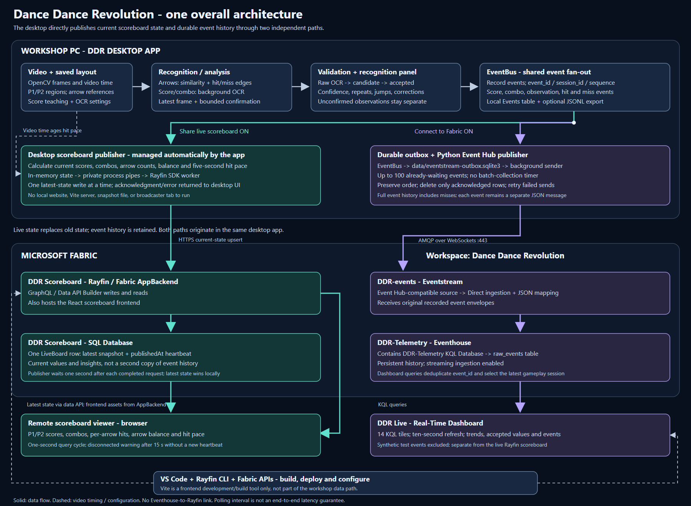
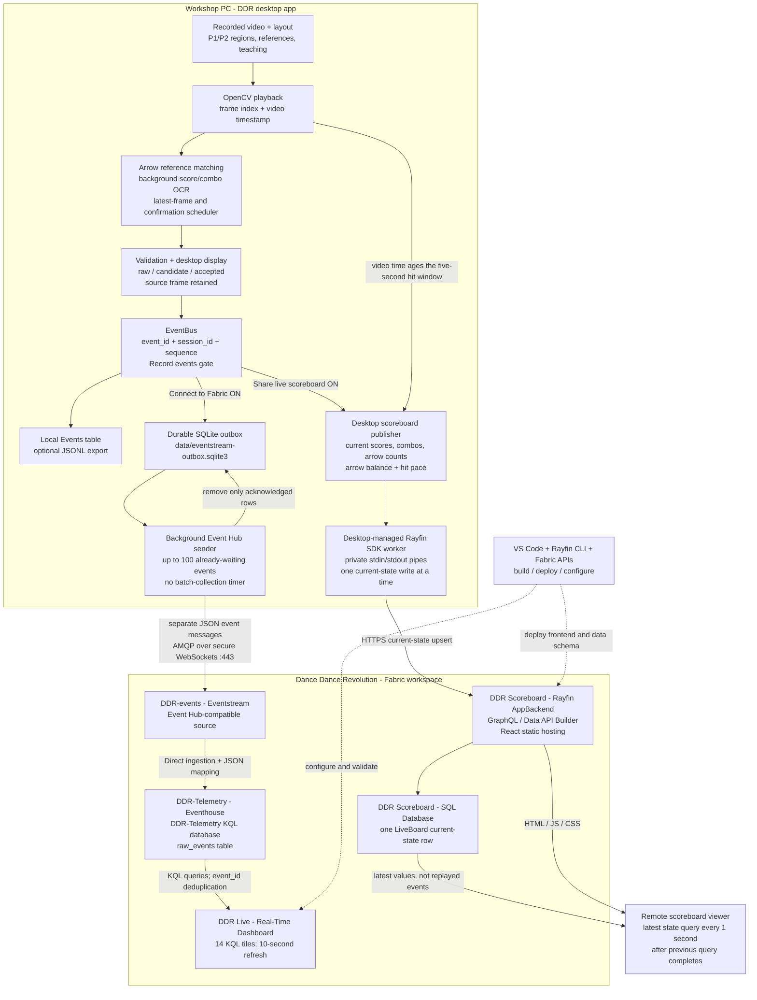

# DDR workshop: overall architecture

One desktop event source feeds two independent publishing paths. The live path
publishes current state directly to Rayfin; the historical path preserves events
in Eventhouse. This diagram focuses on components and data flow.



[Scalable SVG](architecture.svg)



## What changed

The workshop no longer needs a local Vite server, local snapshot file, or
`#publish` broadcaster tab. The desktop performs the state calculations internally
and owns a small SDK worker process. It starts and stops that process when sharing
is enabled or disabled.

Vite remains available for **frontend development and building static assets**.
It is not in the live workshop data path.

## The two paths

| | Direct live scoreboard | Fabric event history |
|---|---|---|
| Desktop control | Share live scoreboard | Connect to Fabric |
| Publisher | Desktop-managed Rayfin SDK worker | Background Python Event Hub sender |
| Local state | Latest in-memory player state | Durable SQLite queue of unsent events |
| Cloud target | Rayfin SQL `LiveBoard` current-state row | Eventstream -> Eventhouse `raw_events` |
| Delivery | Latest state after each completed request; no replay queue | Original events, ordered within a session, retained until acknowledged |
| Cadence | One-second wait between completed publish cycles | Immediate send; groups only events already waiting |
| Consumer | Hosted React scoreboard, one-second query cycle | DDR Live KQL dashboard, ten-second auto-refresh |
| On failure | Visible desktop error; retain latest state for retry | Durable retry/backoff; duplicate deliveries possible |
| What remains running | DDR desktop app | DDR desktop app |

Both feeds use recorded events. Turning off **Record events** stops new events
from reaching either feed. Their connect/share controls remain independent.
Neither feed sends video footage or teaching/reference images.

## Events and calculations

Events carry `event_id`, `session_id`, `sequence`, `event_type`, `player`,
`frame_index`, `video_time_ms`, `observed_at_utc`, `payload` and confidence.

- `score_changed` and `combo_changed`: accepted numeric changes.
- `score_observed`: unconfirmed score candidates, shown separately.
- `arrow_hit` and `arrow_miss`: detected arrow-state transitions.
- `new_session`: sequence 0, announcing the in-memory game GUID shared by both
  players. Payload includes the new and previous IDs, `is_new_session: true`,
  and the reason (`initial`, `video_loaded`, `manual`, or `game_end`).
  Lifecycle events are recorded even with gameplay recording disabled.

A shared `game_end` region matches user-captured end-indicator references at
video rate. Confirmed matches rotate the GUID once, retain historical events,
reset numeric/arrow trackers and scoreboard totals, and suppress gameplay
readings until confirmed disappearance. Session rotation drains active OCR
under the old GUID and invalidates queued jobs from that session.
Reference images travel with layouts; footage and references are not published.
Backward seeks do not regenerate boundaries or reconstruct historical GUIDs.

The live display includes Left/Down/Up/Right hit counts and total hits, but not
miss counts. Misses still remain in Fabric history.

**Arrow balance** is each direction's share of detected hits, not accuracy.
**Hit pace** is detected hits in the last five seconds of video divided by five.
Pause holds the source-time rate; seeks clear recent pace; New Session clears
session totals. Network arrival time does not determine hit pace.

The live state rejects old numeric sequences, deduplicates event IDs for the
active sharing session, and changes sessions through manual/video-load resets
or calibrated game-end detections. Later accepted downward corrections are still valid. The SDK worker
rejects revisions older than its last acknowledged revision.

These rules describe the single desktop publisher. They are not a distributed
multiple-writer protocol or a server-side conditional-write guarantee.

## Storage and Fabric items

| Item | Purpose |
|---|---|
| Local video files | Source footage |
| `layouts/*.json` | Regions, reference images, score examples, OCR settings |
| EventBus memory / JSONL export | Local event history |
| Desktop scoreboard state (memory) | Current P1/P2 values and insight counters |
| `data/eventstream-outbox.sqlite3` | Unacknowledged Fabric history events |
| **DDR Scoreboard** AppBackend | Rayfin data API and hosted React viewer |
| **DDR Scoreboard** SQLDatabase | Current `LiveBoard` snapshot + publish heartbeat |
| **DDR-events** Eventstream | Receives Event Hub-compatible desktop messages |
| **DDR-Telemetry** Eventhouse and KQLDatabase | Persistent `raw_events` table |
| **DDR Live** KQLDashboard | Current/historical visualizations and event feed |

Cloud resources use the existing **Dance Dance Revolution** workspace and
capacity. No additional cloud relay, SignalR service, or Rayfin Function is used.
There is **no Eventhouse-to-Rayfin connector** in the running design.

## Timing

```text
Live display age = OCR/acceptance delay + publish cycle/network + viewer query cycle
History display age = OCR/acceptance delay + outbox/network + ingestion + dashboard refresh
```

A one-second polling setting is not a one-second end-to-end guarantee.
Viewer tabs can be throttled in the background. Last values are marked stale
when the desktop publish heartbeat stops changing for fifteen seconds.

Use video time for gameplay calculations and sequence numbers for event order.
Use monotonic elapsed time or synchronized clocks when measuring transport delay.

## Code map

- [Desktop controller](../app/ui/app_window.py): playback, OCR jobs, display and sharing controls.
- [Video source](../app/video_source.py): decoding, skips, seeks and source time.
- [Analysis](../app/analysis.py) / [OCR engine](../app/ocr_engine.py): recognition and acceptance.
- [EventBus](../app/event_bus.py): session bookkeeping, exports and fan-out.
- [Live scoreboard](../app/live_scoreboard.py): current state, insights and publisher lifecycle.
- [SDK pipe transport](../app/rayfin_sender.py): managed Node process and acknowledgments.
- [SDK worker](../scoreboard/scripts/publish.ts): direct Rayfin writes.
- [Fabric sender](../app/eventstream.py): durable queue, sends, retry and acknowledgment.
- [Viewer](../scoreboard/src/App.tsx) / [state contract](../scoreboard/src/state.ts): polling and display.
- [Rayfin entity](../scoreboard/rayfin/data/LiveBoard.ts): current-state SQL shape.
