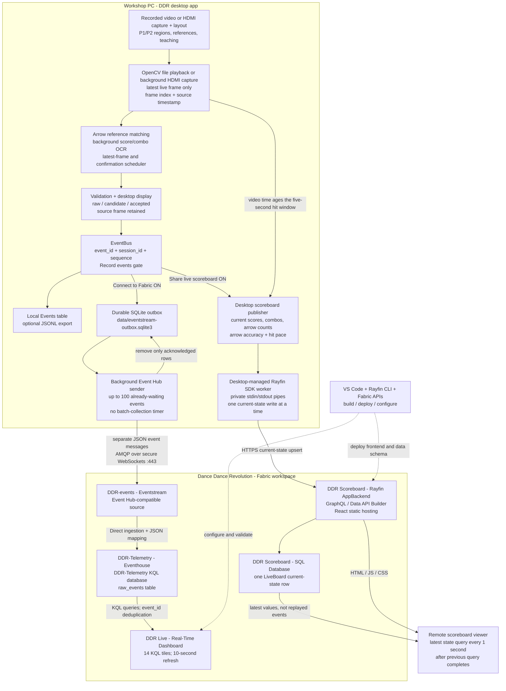

# DDR workshop: overall architecture

One desktop event source feeds two independent publishing paths. The live path
publishes current state directly to Rayfin; the historical path preserves events
in Eventhouse. This diagram focuses on components and data flow.


[Scalable SVG](architecture.svg)



## What changed

The workshop no longer needs a local Vite server, local snapshot file, or
`#publish` broadcaster tab. The desktop performs the state calculations internally
and owns a small SDK worker process. It starts and stops that process when sharing
is enabled or disabled.

Vite remains available for **frontend development and building static assets**.
It is not in the live workshop data path.

## The two paths

| | Direct live scoreboard | Fabric event history |
|---|---|---|
| Desktop control | Share live scoreboard | Connect to Fabric |
| Publisher | Desktop-managed Rayfin SDK worker | Background Python Event Hub sender |
| Local state | Latest in-memory player state | Durable SQLite queue of unsent events |
| Cloud target | Rayfin SQL `LiveBoard` current-state row | Eventstream -> Eventhouse `raw_events` |
| Delivery | Latest state after each completed request; no replay queue | Original events, ordered within a session, retained until acknowledged |
| Cadence | One-second wait between completed publish cycles | Immediate send; groups only events already waiting |
| Consumer | Hosted React scoreboard, one-second query cycle | DDR Live KQL dashboard, ten-second auto-refresh |
| On failure | Visible desktop error; retain latest state for retry | Durable retry/backoff; duplicate deliveries possible |
| What remains running | DDR desktop app | DDR desktop app |

Both feeds use recorded event envelopes from the selected source. Turning off
**Record events** stops new gameplay events; lifecycle announcements continue.
Their connect/share controls remain independent.
Neither feed sends video footage or teaching/reference images.

## Shared-device player registration

The Rayfin frontend's `#register` route is an organizer-authenticated kiosk.
Players need no Microsoft accounts. SQL `GameSession` rows track the game GUID
and heartbeat published by the desktop. `GamePlayerSession` holds the generated
name, optional PIN, game GUID, station, registration type, and relay status.
Required `?player=1` / `?player=2` kiosk flags persist `P1` / `P2` on the
registration and event envelope. A unique game/player `slotKey` allows just two
rows per game, shared by normal and no-PIN special entries; SQL rejects racing
claims for the same station. Normal names and PINs have unique reservation keys.
The tablet invokes one authenticated `registerPlayer` Rayfin function, passing
a request UUID, station, and optional special name. The server selects the
game, generates credentials, checks history, and creates the slot via the
caller-scoped `ctx.getDataClient()`. Retry IDs recover a saved pass without
claiming a second slot; the function does not elevate database permissions.
Only player-pass fields return to the tablet. Per-operation duration/status logs
exclude names, PINs, tokens, and database response bodies.
Historical `UserSession` and `SpecialSession` rows remain readable but cannot be
created or have their identity fields updated through the old APIs. Their assigned
stations still count; ambiguous pre-limit games must be replaced with a new game.
Corner gestures register the three special names but
never bypass Microsoft authentication or grant authorization.
These tables are accessible only to the authorized publisher account, unlike the
scoreboard's authenticated-reader view. The kiosk rejects inactive or stale games.

The desktop SDK worker reads pending registrations with each publish cycle.
Current slots and historical registrations share a 25-row limit, ordered by creation time,
and are acknowledged to their respective SQL tables only after durable enqueue.
Python writes their `user.register` envelopes into the same durable Eventstream
outbox as gameplay. Only a successful queue write is acknowledged back to SQL
on the next cycle. `eventQueued` means queued, not Eventhouse-ingested.
Failures retain SQL rows for retry; duplicate deliveries use the same event ID.
Normal registrations include their six-digit string PIN in `payload.pin`;
special no-PIN registrations omit it. The PIN is stored in the local outbox and
Eventhouse, so restrict both to trusted organizers. Public scoreboard snapshots
and logs still exclude PINs. Already relayed registrations are not backfilled.
Players photograph the saved name/PIN screen
for future validation; gameplay player assignment and PIN redemption are separate,
not yet implemented.

The kiosk's secondary Easy mode action calls `registerEasyPlayer`, which uses
the same authenticated registration and station reservation path. Both registration
functions claim an immutable `GameSessionMode` row whose primary key is the game
UUID. The first claim chooses easy or normal; a concurrent duplicate-key loser
reads and inherits the winner rather than saving a different player mode.
The lock grants only organizer-scoped read/create permissions, not update/delete.
Special entries and retries inherit the same mode; only a new game UUID resets it.
Existing registrations seed the lock, and mixed historical modes require a new
session rather than retagging events. A failed player write retains its mode lock.
The kiosk polls `getRegistrationMode` for display, but registration functions
enforce the invariant independently of kiosk state.

Each registration persists the locked mode as `excludeFromLeaderboard`; historical
null/missing flags count as normal. The relay preserves this as
`user.register.payload.exclude_from_leaderboard`. Future leaderboard consumers
must join by game session and player and exclude flagged entries. Live scoreboard
participation and gameplay event calculations are unaffected.

This adds a SQL registration path, not an Eventhouse query connector. Both
**Share live scoreboard** and **Connect to Fabric** must be configured for
end-to-end registration delivery. The earlier overview diagram shows gameplay
and scoreboard paths; this registration relay joins them at the desktop outbox.

## Desktop video sources

**Video file** preserves sequential playback, frame stepping, and explicit
seek detection. **HDMI input** enumerates named Windows DirectShow devices
without opening them, then opens only the user-selected card. Opening and
reading occur on a dedicated capture thread with a single latest-frame slot.
Tk polls for new frames without blocking on the driver.

HDMI preview can freeze for calibration, but capture continues and resuming
returns to the newest frame. Live events use `source_mode: live`, capture frame
indices, and monotonic milliseconds since the connection opened. They flow
through the same analysis, game-end GUID rotation, scoreboard, and durable
publishing paths as replay events. Connecting emits `new_session` with reason
`hdmi_connected`. Switching sources stops analysis, invalidates queued OCR, and
starts a fresh session only after the new source delivers a valid frame.
Calibration is explicitly fitted or removed when the source resolution changes.

No audio or video-file recording is added. Connection failures, signal loss,
five-second frame stalls, and resolution changes are visible errors rather
than EOF or successful blank frames. A blocked driver shutdown is reported;
the app does not silently keep capturing or open another copy of the device.

## Events and calculations

Events carry `event_id`, `session_id`, `sequence`, `event_type`, `player`,
`frame_index`, `video_time_ms`, `observed_at_utc`, `payload` and confidence.

- `score_changed` and `combo_changed`: accepted numeric changes.
- `score_observed`: unconfirmed score candidates, shown separately.
- Arrow references identify activity using fresh `active` samples; old `hit`/`miss`
  arrow images are ignored with a recalibration warning. Old `appeared` samples
  are also ignored. Optional per-region `empty` references suppress look-alike
  receptors: Active must pass the configured similarity threshold and exceed the
  best Empty similarity by more than 0.02. Ties and near-ties remain idle.
  All five directions for each player have independent Active/Empty capture,
  thumbnail, clear, gallery, and individual deletion controls. Both reference sets
  serialize and rescale with layouts. Active-only layouts preserve prior behavior.
  The arrow preview reports Active similarity and explains Empty overrides in status.
  Without Active Arrow calibration no lane evidence is produced.
- `arrow_hit` and `arrow_miss`: judgment-correlated outcomes only. Arrow activity
  alone never determines success or failure, even without a judgment box.
- Per-player `judgment` regions compare Perfect/Great/Good/Miss reference images
  at source-frame rate. Their new pulses determine outcome type, with arrow
  activity matched from 500 ms before to 150 ms after the word's source-time onset.
  A 650 ms settling interval after the word
  detects competing judgments. Ambiguous directions produce `judgment_hit` or
  `judgment_miss` with `direction: null`, never a guessed lane. A lingering judgment
  cannot validate repeated arrows; 250 ms of source-video time without an outcome
  match must rearm the box before any next judgment, including a different word.
  Ambiguous strong matches and crop/calibration errors restart that interval. Pending
  evidence is cleared on seek, stop, recording/layout/source changes and new games.
  Arrow evidence remains eligible for retention through the full delayed-word and
  settling interval (up to 1,150 ms). Payloads include `correlation_lookback_ms`
  and `correlation_lookahead_ms`; legacy `correlation_window_ms` is the maximum
  of these allowances, not a symmetric window.
  Perfect, Great, and Good emit hit outcomes, retaining their tier in `payload.judgment`;
  Miss retains the miss outcome. Legacy Success references remain ungraded until
  tier calibration starts. Legacy Blank references are ignored; no background
  snapshot is required. Sustained matching failures can look like disappearance.
  Partial calibration recognizes taught outcomes without requiring all four
  categories. Missing categories show actionable warnings;
  no outcome references is a blocking calibration error.
  Simultaneous distinct directions receive the same judgment, emitting one arrow
  outcome per direction. All onsets must span at most 150 ms and each lane must
  uniquely match this judgment; repeated directions or competing judgments remain
  unassigned. Each event has its own ID for delivery deduplication plus a shared
  `payload.judgment_id`, `step_directions`, and `step_arrow_count` for step grouping.
  Existing arrow totals count each arrow; distinct judgment IDs count judged steps.
  The desktop also accumulates `runningScore` per player: Good 10, Great 20,
  Perfect 40, Miss 0 points per outcome event. Unknown-direction judgments score
  once; legacy ungraded hits score zero. Event-ID deduplication and game resets
  apply to points as well as counts. OCR score fields remain separate; the React
  scoreboard prefers `runningScore`, including zero, and falls back to accepted
  OCR score only for older snapshots. Sharing must be enabled before gameplay;
  restarting sharing starts fresh state without replaying prior events.
  Player totals and pace include directionless outcomes; lane counts/titles and
  response timing exclude them. Desktop snapshots carry `unassignedHits` and
  `unassignedMisses` for the viewer. Calibration references serialize inside layouts.
  The desktop keeps calibration independent for each player: arrow activity,
  Perfect/Great/Good/Miss images, and taught score/combo digit templates (including
  review/version metadata). Capturing, clearing, or teaching one region never modifies
  the other player's samples. Matching P2 boxes still adopt P1 width and
  height when drawn or loaded; resizing retains their centers where frame bounds
  permit. The Regions size-matching action also applies this to the current layout.
  With drawing disabled, existing boxes can be dragged without resizing; release
  updates their position, resets recognition tracking, and refreshes previews.
  Positions, trackers and per-player preprocessing remain independent. Adding regions
  starts them without calibration; loading retains each region's saved samples.
  Old layouts containing copied shared samples are not cleared automatically;
  recapture each player's examples as needed and save the layout.
- Appearance calibration is removed. New events do not emit `arrow_appeared`
  or appearance-based response-duration fields; legacy layout images remain
  stored but are ignored.
- `new_session`: sequence 0, announcing the in-memory game GUID shared by both
  players. Payload includes the new and previous IDs, `is_new_session: true`,
  and the reason (`initial`, `video_loaded`, `hdmi_connected`, `manual`, or `game_end`).
  Lifecycle events are recorded even with gameplay recording disabled.
- `session_end`: emitted with the old GUID and its next sequence before a new
  GUID is announced. Payload contains the old and next session IDs and reason.
  Manual **New Session**, source changes, and calibrated game ends all use this
  ordering; an unannounced initial GUID has no end event. Both events enter the
  durable outbox and Events table. The Rayfin worker closes the previous SQL
  game with `active: false` and `endedAt` before publishing the replacement.

A shared `game_end` region matches user-captured end-indicator references at
video rate. Confirmed matches rotate the GUID once, retain historical events,
reset numeric/arrow trackers and scoreboard totals, and suppress gameplay
readings until confirmed disappearance. Session rotation drains active OCR
under the old GUID and invalidates queued jobs from that session.
Reference images travel with layouts; footage and references are not published.
Backward seeks do not regenerate boundaries or reconstruct historical GUIDs.

The live display includes Up-Right/Up-Left/Down-Right/Down-Left/Center hit counts
and total hits. Miss totals contribute to cumulative hit percentage:
`hits / (hits + misses) * 100` for detected outcomes this game, not all chart notes.
Misses also remain in Fabric history. Without miss calibration this percentage
can overstate actual performance; old snapshots without miss totals hide it.
The desktop direction selector, region keys, arrow events, and scoreboard use
these same five names. Loading a legacy layout warns and removes unsupported
arrow regions from the active setup while keeping numeric, game-end, and
supported arrow regions; the saved file is unchanged until explicitly saved.
The viewer rejects old four-direction snapshots instead of inventing a mapping.

**Arrow balance** is each direction's share of detected hits, not accuracy.
**Hit pace** is detected hits in the last five seconds of video divided by five.
Pause holds the source-time rate; seeks clear recent pace; New Session clears
session totals. Network arrival time does not determine hit pace.

**Time to answer** is now legacy-only: new analysis events carry no response
timing, so new game snapshots have null `averageResponseTimeMs` and zero
`responseSamples`. The viewer hides timing and animal cards without samples.
Historical snapshots and event consumers retain timing validation for compatibility.

Animal comparisons cite the [mouse visual-escape reference, approximately
250 ms](https://pmc.ncbi.nlm.nih.gov/articles/PMC3809337/) and [goldfish auditory
C-start mean, 10.64 ms at 0-30 cm from the
speaker](https://pmc.ncbi.nlm.nih.gov/articles/PMC8776867/). The UI identifies the
different tasks/senses and does not present them as equivalent tests or a
universal speed ranking.
The highest per-lane hit percentage determines the step title and its matching
direction symbol, using `hitsByDirection` and `missesByDirection`. Unknown-direction
outcomes and unplayed lanes are excluded. A positive five-way accuracy tie is
All-Step Ace; zero accuracy and partial ties award no title. No minimum sample count
is required. Legacy snapshots without lane misses omit titles instead of guessing.
All metric cards without supporting data are omitted rather than left empty.

The live state rejects old numeric sequences, deduplicates event IDs for the
active sharing session, and changes sessions through manual/video-load resets
or calibrated game-end detections. Later accepted downward corrections are still valid. The SDK worker
rejects revisions older than its last acknowledged revision.

These rules describe the single desktop publisher. They are not a distributed
multiple-writer protocol or a server-side conditional-write guarantee.

## Storage and Fabric items

| Item | Purpose |
|---|---|
| Local video files | Source footage |
| `layouts/*.json` | Regions, reference images, score examples, OCR settings |
| EventBus memory / JSONL export | Local event history |
| Desktop scoreboard state (memory) | Current P1/P2 values and insight counters |
| `data/eventstream-outbox.sqlite3` | Unacknowledged Fabric history events |
| **DDR Scoreboard** AppBackend | Rayfin data API and hosted React viewer |
| **DDR Scoreboard** SQLDatabase | Current `LiveBoard` snapshot + publish heartbeat |
| **DDR-events** Eventstream | Receives Event Hub-compatible desktop messages |
| **DDR-Telemetry** Eventhouse and KQLDatabase | Persistent `raw_events` table |
| **DDR Live** KQLDashboard | Current/historical visualizations and event feed |

Cloud resources use the existing **Dance Dance Revolution** workspace and
capacity. No additional cloud relay, SignalR service, or Rayfin Function is used.
There is **no Eventhouse-to-Rayfin connector** in the running design.

## Timing

```text
Live display age = OCR/acceptance delay + publish cycle/network + viewer query cycle
History display age = OCR/acceptance delay + outbox/network + ingestion + dashboard refresh
```

A one-second polling setting is not a one-second end-to-end guarantee.
Viewer tabs can be throttled in the background. Last values are marked stale
when the desktop publish heartbeat stops changing for fifteen seconds.

Use video time for gameplay calculations and sequence numbers for event order.
Use monotonic elapsed time or synchronized clocks when measuring transport delay.

## Code map

- [Desktop controller](../app/ui/app_window.py): playback, OCR jobs, display and sharing controls.
- [Video source](../app/video_source.py): decoding, skips, seeks and source time.
- [Live video source](../app/live_video_source.py): named device discovery, bounded HDMI capture and elapsed source time.
- [Analysis](../app/analysis.py) / [OCR engine](../app/ocr_engine.py): recognition and acceptance.
- [EventBus](../app/event_bus.py): session bookkeeping, exports and fan-out.
- [Live scoreboard](../app/live_scoreboard.py): current state, insights and publisher lifecycle.
- [SDK pipe transport](../app/rayfin_sender.py): managed Node process and acknowledgments.
- [SDK worker](../scoreboard/scripts/publish.ts): direct Rayfin writes.
- [Fabric sender](../app/eventstream.py): durable queue, sends, retry and acknowledgment.
- [Viewer](../scoreboard/src/App.tsx) / [state contract](../scoreboard/src/state.ts): polling and display.
- [Rayfin entity](../scoreboard/rayfin/data/LiveBoard.ts): current-state SQL shape.
